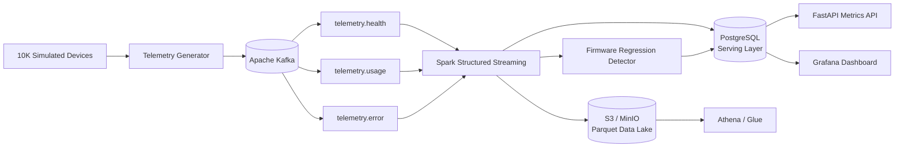

# Real-Time Device Telemetry Platform

Production-style streaming data platform that simulates **10,000 connected devices**, ingests telemetry through Apache Kafka, processes events with Spark Structured Streaming, serves low-latency operational aggregates from PostgreSQL, and lands partitioned Parquet data in an S3-compatible data lake for Athena-style analytics.

The project is intentionally designed as a **data-engineering portfolio system** rather than a single-script demo: it includes event contracts, schema validation, idempotency, watermarking, deduplication, data-quality signals, regression detection, observability, tests, CI, Terraform, and an operations runbook.

## What it demonstrates

- High-volume event generation for a 10K-device fleet
- Kafka topic design, partitioning, keys, compression, and producer backpressure
- Spark Structured Streaming with event-time processing, watermarks, and deduplication
- Near-real-time firmware/region/device-health aggregates
- Automated firmware regression detection against fleet baselines
- PostgreSQL serving layer for dashboards and APIs
- S3-compatible Parquet lake with date/hour/region/event-type partitions
- Athena/Glue-compatible analytical SQL and AWS infrastructure scaffolding
- Grafana visualization, FastAPI serving layer, health checks, CI, unit tests, and runbooks

## Architecture



## Event contract

Representative event:

```json
{
  "schemaVersion": "1.0",
  "eventId": "1cb9f988-b9fe-4fd6-b7e7-10373974c4eb",
  "eventType": "health",
  "deviceId": "dev-000042",
  "firmwareVersion": "2.3.0",
  "timestamp": "2026-10-14T09:52:31.231Z",
  "batteryLevel": 82.4,
  "latencyMs": 46.8,
  "connectionState": "CONNECTED",
  "errorCode": null,
  "region": "ap-south-1",
  "deviceType": "smart-display",
  "signalStrengthDbm": -51,
  "uptimeSeconds": 188023,
  "sessionId": "6b66438d-99e0-49d1-92e0-98a664bcf09c"
}
```

See [`docs/data-contract.md`](docs/data-contract.md) for validation and compatibility rules.

## Quick start

Prerequisites: Docker Desktop with at least **6 GB memory** allocated, GNU Make, and `curl`.

```bash
cp .env.example .env
make up
```

The default generator models **10,000 devices** and emits 500 events/sec so it runs comfortably on a laptop. Raise `EVENTS_PER_SECOND` in `.env` for load testing.

Wait until the services are healthy, then:

```bash
make smoke
```

Open:

- Grafana: <http://localhost:3000> — `admin` / `admin`
- Metrics API docs: <http://localhost:8080/docs>
- MinIO console: <http://localhost:9001> — `minioadmin` / `minioadmin`

Useful API calls:

```bash
curl -s http://localhost:8080/health | jq
curl -s http://localhost:8080/api/v1/firmware | jq
curl -s http://localhost:8080/api/v1/regions | jq
curl -s http://localhost:8080/api/v1/alerts | jq
```

## Demo scenario: firmware regression

Firmware `2.3.0` is intentionally configured with an elevated error probability in the generator. After sufficient samples accumulate, the streaming job compares each firmware version with the current fleet baseline and writes alerts when the minimum-sample and regression thresholds are met.

```bash
curl -s http://localhost:8080/api/v1/alerts?limit=20 | jq
```

You can tune the detector using:

```dotenv
REGRESSION_MIN_EVENTS=50
REGRESSION_FAILURE_MULTIPLIER=2.0
REGRESSION_FAILURE_ABS_THRESHOLD=0.05
REGRESSION_LATENCY_MULTIPLIER=1.5
```

## Analytics implemented

| Question | Serving/output |
|---|---|
| Failure rate by firmware | `firmware_metrics.failure_rate` |
| Connection failures | `region_metrics.connection_failures` and firmware metrics |
| P95 device latency | `firmware_metrics.p95_latency_ms`, `region_metrics.p95_latency_ms` |
| Error rate by region | `region_metrics.error_rate` |
| Device health trends | `device_health_metrics` |
| Firmware regression detection | `regression_alerts` |
| Data quality/rejected records | `pipeline_quality` |
| Historical ad-hoc analysis | S3 Parquet + Athena SQL |

## Repository layout

```text
.
├── generator/                 # 10K-device telemetry simulator + Kafka producer
├── streaming/                 # Spark Structured Streaming processing job
├── metrics-api/               # FastAPI read-only serving API
├── sql/                       # PostgreSQL + Athena analytical SQL
├── grafana/                   # Provisioned datasource and dashboard
├── infra/terraform/           # S3, Glue database and Athena workgroup
├── docs/                      # Architecture, data contract, runbook, resume bullets
├── scripts/                   # Smoke test and benchmark utilities
├── .github/workflows/ci.yml   # CI pipeline
├── docker-compose.yml         # Complete local environment
└── Makefile
```

## Engineering decisions

**Kafka key = `deviceId`.** Events from the same device retain partition-local ordering while still distributing the fleet across partitions.

**Event time, not processing time.** Spark parses `timestamp` to `eventTime`, applies a 2-minute watermark, and deduplicates on `(eventId, eventTime)` to handle retries and late delivery.

**Hot and cold serving paths.** Aggregates go to PostgreSQL for low-latency operational queries. Curated events land as Parquet for historical analytics and cost-efficient scans.

**At-least-once friendly sinks.** Aggregate snapshots carry deterministic `batch_id` + dimensions and use PostgreSQL conflict handling. S3 objects are named by Spark batch ID plus partition dimensions to make retries deterministic.

**Regression detection uses baselines.** A firmware version is flagged only after a minimum sample count and when its failure rate or P95 latency materially exceeds the fleet baseline.

## Tests and CI

```bash
make test
```

CI validates Python code, unit tests, event-generation logic, regression-detection math, and Docker Compose configuration.

## AWS path

The local stack uses MinIO so the entire repository is runnable without an AWS account. The lake layout is compatible with S3. [`infra/terraform`](infra/terraform) provisions:

- encrypted/versioned S3 data-lake bucket
- AWS Glue catalog database
- Athena workgroup and query-results location

For a production deployment, replace local Kafka with Amazon MSK/MSK Serverless, PostgreSQL with Amazon RDS/Aurora PostgreSQL, and run the Spark job on EMR Serverless, Glue streaming, or EMR on EKS. See [`docs/aws-production.md`](docs/aws-production.md).

## Resume-ready positioning

See [`docs/resume-bullets.md`](docs/resume-bullets.md) for defensible project bullets and a recommended GitHub description. Do **not** claim benchmark numbers until you run `make benchmark` on your machine and record the results.

## License

MIT


### Image pull fixes (October 2026)

The Compose stack now uses Confluent Kafka `7.7.12`, Chainguard MinIO, and official Spark `3.5.3-python3`. An internal Python-based bucket initializer replaces the withdrawn `minio/mc` image. On Apple Silicon these are intended to avoid amd64-only image dependencies. First run:

```bash
docker compose config --quiet
docker compose pull kafka postgres minio grafana
make up
make ps
```

If the object-storage image reports registry authorization errors, verify access to `cgr.dev` on your network. The previous Docker Hub `minio/mc` image is no longer available. Docker images have not been integration-tested in the repository packaging environment.
